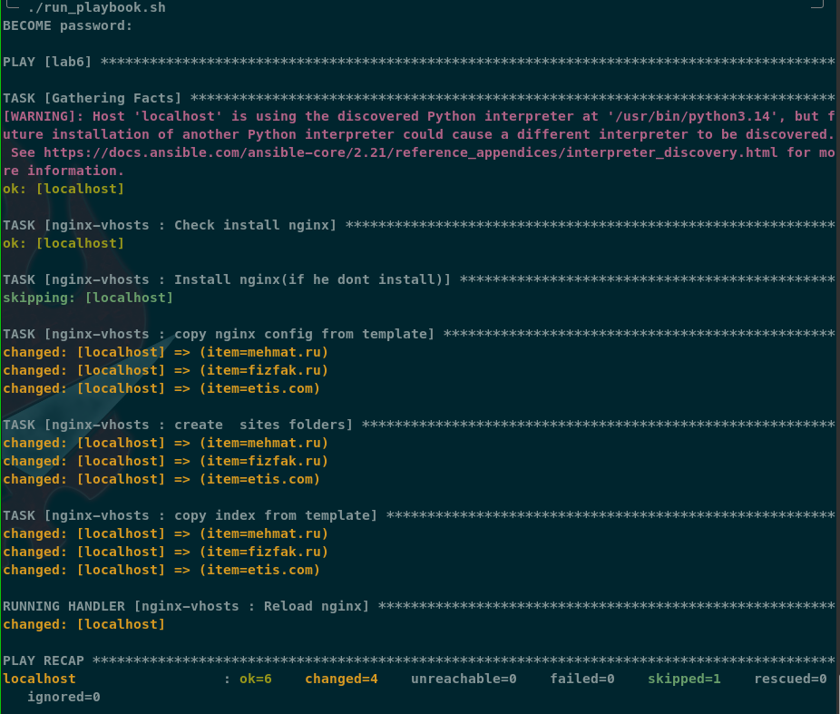
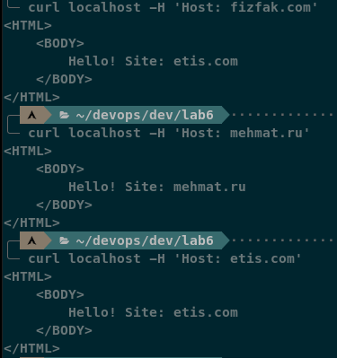
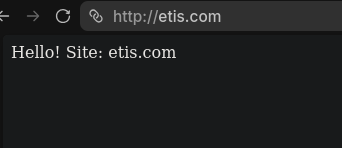
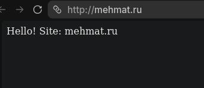
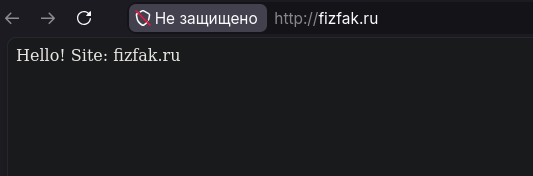

Я Климов Сергей Сергеевич, ИТ-14. Все файлы работы лежат в репозитории. Здесь я описал результаты выполнения лабораторной работы 6 по предмету "Devops и администрирование (Методы и инструменты DevOps)".

#### Логи run_playbook.sh


в виде текста (есть отдельный файл log_run_playbook.txt с этим же выводом):
```bash
╰─ ./run_playbook.sh                                                                               ─╯
BECOME password: 

PLAY [lab6] ******************************************************************************************

TASK [Gathering Facts] *******************************************************************************
[WARNING]: Host 'localhost' is using the discovered Python interpreter at '/usr/bin/python3.14', but future installation of another Python interpreter could cause a different interpreter to be discovered. See https://docs.ansible.com/ansible-core/2.21/reference_appendices/interpreter_discovery.html for more information.
ok: [localhost]

TASK [nginx-vhosts : Check install nginx] ************************************************************
ok: [localhost]

TASK [nginx-vhosts : Install nginx(if he dont install)] **********************************************
skipping: [localhost]

TASK [nginx-vhosts : copy nginx config from template] ************************************************
changed: [localhost] => (item=mehmat.ru)
changed: [localhost] => (item=fizfak.ru)
changed: [localhost] => (item=etis.com)

TASK [nginx-vhosts : create  sites folders] **********************************************************
changed: [localhost] => (item=mehmat.ru)
changed: [localhost] => (item=fizfak.ru)
changed: [localhost] => (item=etis.com)

TASK [nginx-vhosts : copy index from template] *******************************************************
changed: [localhost] => (item=mehmat.ru)
changed: [localhost] => (item=fizfak.ru)
changed: [localhost] => (item=etis.com)

RUNNING HANDLER [nginx-vhosts : Reload nginx] ********************************************************
changed: [localhost]

PLAY RECAP *******************************************************************************************
localhost                  : ok=6    changed=4    unreachable=0    failed=0    skipped=1    rescued=0    ignored=0   


```

#### Логи curl


в виде текста (есть отдельный файл log_run_playbook.txt с этим же выводом):
```bash
curl localhost -H 'Host: fizfak.com'
<HTML>
    <BODY>
        Hello! Site: etis.com
    </BODY>
</HTML>

curl localhost -H 'Host: mehmat.ru'
<HTML>
    <BODY>
        Hello! Site: mehmat.ru
    </BODY>
</HTML>

curl localhost -H 'Host: etis.com'
<HTML>
    <BODY>
        Hello! Site: etis.com
    </BODY>
</HTML>

```

#### В браузере:





